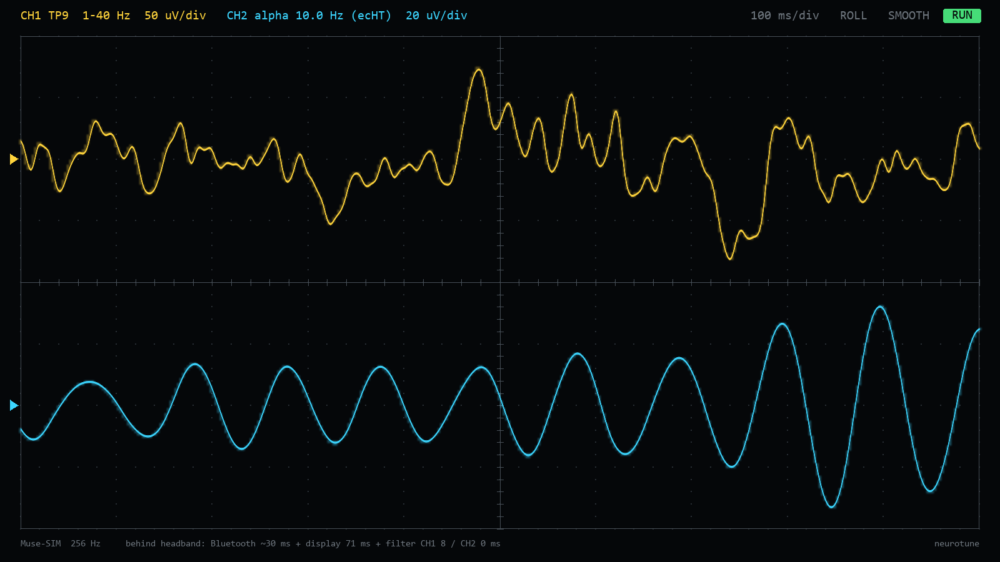

# neurotune

Sound locked to your brainwaves, using a Muse S on a Windows PC. It's a DIY take on what [Elemind](https://www.nature.com/articles/s41598-024-63385-1) does.



*The built-in oscilloscope (`python -m neurotune scope`), here running on the simulated headband. Yellow is the raw EEG, 1–40 Hz. Cyan is the alpha wave as the tracker sees it, re-estimated at every sample with no phase lag.*

It tracks your alpha rhythm (the 8–12 Hz wave that is strong when you're relaxed with your eyes closed). It predicts when the next wave will arrive and fires a short sound so the brain's response to it lands on a chosen point of the wave. Elemind's trial aimed responses at the alpha trough, which lowers alpha. In their trial that cut the time to fall asleep from 35.8 to 25.3 minutes on average.

Two modes:

- **sleep**: Elemind's recipe. 1/f pink-noise bursts a quarter of an alpha cycle long, over quiet rain 18 dB below them, for 30 minutes. It fades out when it detects you falling asleep.
- **music**: the same brain-locked timing, but every burst is a pitched shimmer on a slow D Dorian chord progression. The pad gets brighter as you relax, breathes at 6 breaths per minute, and darkens and quietens as you get drowsy.

Add `--osc 127.0.0.1:9000` and every pulse and state update is also sent as OSC. That way Ableton (through Max for Live), TouchDesigner or Max can play **your own** sounds on the brain-locked beats.

> This is an experiment, not a medical device. Keep the volume low, and stop if anything feels off.

---

## 1. Get the Muse talking to the PC

The Muse uses **Bluetooth Low Energy**. Phones handle it well; on Windows you need to:

1. **Unpair it from Windows.** Settings → Bluetooth & devices: if the Muse is listed, remove it. Apps connect to it directly.
2. **Switch off Bluetooth on your phone**, or at least close the Muse app. The headband only talks to one device at a time.
3. **Check your PC has Bluetooth 4.0+.** If BlueMuse can't find the Muse, buy a USB Bluetooth 5.0 dongle (around £10–15, e.g. TP-Link UB500). Put it in a front USB 2 port or on a short extension, because USB 3 ports interfere with 2.4 GHz.
4. **Install a streamer** that puts the Muse onto LSL (Lab Streaming Layer):
   - **Muse S Gen 2:** [BlueMuse](https://github.com/kowalej/BlueMuse) (Windows app). Start it, pick your Muse and press Start Streaming.
   - **Muse S Athena (MS-03):** BlueMuse support is marked experimental. If it fails, use [OpenMuse](https://github.com/DominiqueMakowski/OpenMuse):
     ```
     pip install https://github.com/DominiqueMakowski/OpenMuse/zipball/main
     OpenMuse find
     OpenMuse stream --address <address from find>
     ```

neurotune connects to whichever EEG stream it finds.

## 2. Install

Install Python 3.11+ from python.org and tick "Add to PATH". Then, in a terminal in this folder (in VS Code: Terminal → New Terminal):

```
pip install -r requirements.txt
```

Try it without the headband first:

```
python -m neurotune offline --mode music      # whole loop on a virtual clock -> WAV + accuracy report
python -m neurotune simulate                  # terminal 1: a fake Muse on LSL
python -m neurotune run --mode music          # terminal 2: live, through your speakers
```

## 3. Use it with the Muse

```
python -m neurotune calibrate                 # 2 min, eyes closed: finds your alpha frequency + best sensor
python -m neurotune run --mode sleep          # lie down, eyes closed
python -m neurotune run --mode music --minutes 20
python -m neurotune analyze sessions/<file>.npz   # how well pulses hit the target
python -m neurotune scope                     # live oscilloscope of the raw EEG and tracked alpha
```

- Use **wired** headphones or speakers. Bluetooth audio adds 150–300 ms of shifting delay, which ruins the timing.
- Wet the forehead sensors slightly and make sure the band sits snugly. `calibrate` prints the alpha strength for each sensor, and you want ×3 or more. TP9 and TP10 (behind the ears) usually beat the forehead sensors.
- Settings are saved in `neurotune_config.json`.
- `--target peak` aims for the opposite effect (more alpha). `--target 120` sets a raw onset phase in degrees, for experimenting.
- `--gate 0` pulses on every cycle, as Elemind did. The default only pulses when alpha is clearly present, which gives cleaner timing.

## 4. The one calibration that matters: Bluetooth delay

The Muse's timestamps arrive late by the Bluetooth delay, roughly 20–50 ms. At 10 Hz, 35 ms is 126° of phase. In simulation, leaving it uncorrected put pulses **137° off target**, which is close to the opposite effect. Until you measure it, neurotune assumes 30 ms.

**To measure it (optional, about 10 minutes of electronics):** play clicks from the headphone jack into a sensor and see when they show up in the EEG.

- Take a 3.5 mm cable and use the **left channel (tip)** and **ground (sleeve)**.
- Build a divider: tip → **100 kΩ** → node → **100 Ω** → ground. The node is your signal (about 1/1000 of the output).
- With the headband **off your head** and the laptop **unplugged from mains**, touch the node to the **AF7 sensor** and ground to the **centre forehead (reference) sensors**, using a damp cloth or foil.
- Keep the volume low and run:
  ```
  python -m neurotune loopback
  ```
  It plays 40 clicks, finds them in the EEG and saves `eeg_latency_ms` to the config.

## How it works

```
Muse --BLE--> BlueMuse/OpenMuse --LSL--> neurotune
                                          |- brain.py   ecHT phase tracker -> predicts next target phase
                                          |             band powers -> relax / drowsy / asleep
                                          |- synth.py   audio callback drops each pulse in at the exact sample
                                          '- OSC out    -> Ableton / TouchDesigner (optional)
```

- **Phase tracking** uses the endpoint-corrected Hilbert transform (Schreglmann et al. 2021). It's the method Elemind's co-founder Nir Grossman's group developed, and the one used in Elemind's trials. Each new 12-sample packet updates the phase estimate at the newest sample. The code then works out when the wave will next reach the onset phase, which is set so the brain's response (P1, about 60 ms after the sound) lands on the target.
- **Scheduling:** the audio callback knows when its buffer will reach the speakers, so each pulse starts on the exact sample. A pending pulse keeps being re-planned as fresh EEG arrives, right up until it's committed.
- **Sleep detection:** after a 90 s baseline, if alpha has collapsed and theta dominates for 75% of a 90 s window, the sound fades out over 60 s.

## How accurate is it?

Simulated, with realistic noise, Bluetooth packet timing and ±10 ms jitter (`python -m neurotune offline`):

| Setup | Mean error | Spread (circular SD) |
|---|---|---|
| Behind-ear sensor (TP9), delay corrected | 5–12° | 35–39° |
| Forehead sensor (AF7), delay corrected | 6° | 59° |
| TP9, delay **not** corrected | 137° | 38° |

Elemind's purpose-built headband reported 0.5 ± 6.9°. A Muse over Bluetooth won't match that, but with the delay measured it locks clearly to the target. Real-world accuracy depends on how strong your alpha is, so run `analyze` on your own sessions. It also suggests a `phase_bias_deg` you can add to `neurotune_config.json`.

## Ideas next

- Send `/neurotune/pulse` into Ableton and trigger your own instrument, or drive visuals in TouchDesigner.
- Add the other bands: theta-locked sounds for deep relaxation, or slow-oscillation pulses during deep sleep (the published "closed-loop auditory stimulation" for memory).
- Feed the relax and drowsy values into the Scent Channel, or use them to drive Morpheus.
